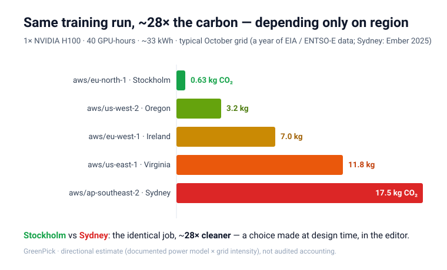

<p align="center">
  
</p>

<h1 align="center">GreenPick</h1>

<p align="center">
  
  
  
  
</p>

A **design-time sustainability co-pilot** that runs as an MCP server inside your vibe-coding
environment (Cursor / Claude Code / Kiro). Ask it where to deploy, when to run a job, or how to
right-size — and it answers with an honest **carbon + cost + latency** tradeoff, in-editor, in
seconds. (It responds when you ask; auto-nudging on infra-code changes is on the roadmap.)

> **Status: working — 15 tools.** Live carbon for US (EIA-930) and EU (ENTSO-E), cross-cloud cost
> parity (Vantage-refreshed), per-axis R/Y/G ratings, carbon-aware scheduling + day-ahead forecast,
> GPU-training **and LLM-inference** carbon, right-sizing, serving-pattern and data-locality/residency
> checks — all shipped. Falls back to clearly-labelled mock data offline or without API keys.

<p align="center">
  
</p>

*The same 40-GPU-hour training run emits ~0.7 kg CO₂ in Stockholm vs ~19 kg in Sydney — a ~30×
difference from region choice alone. Ask GreenPick and it surfaces that (with the cost and latency
tradeoff) while you're still in the editor, before you commit.*

**▶ [See the 5-minute demo](docs/demo.md)** — three scenarios with real tool output (training placement, the egress backfire, the forecast).

## Features

- 🧮 **Right-sizing that cuts cost *and* carbon together** — the FinOps win with a carbon twin. The money saved is the reason to run it; the carbon comes free.
- ⏱ **Carbon-aware scheduling** — run deferrable jobs (ETL, batch, training) when the grid is cleanest, now or day-ahead. A decision you make for *every* recurring job.
- ⚡ **GPU training & LLM inference carbon** — estimate a run's footprint and the greener *where* + *when*; the size/placement choices that actually move the number.
- 🌍 **Greener region picks** — ranked by carbon, with the cost + latency tradeoff shown, not hidden.
- 🛡 **Backfire guards** — flags when a greener move loses to egress, or crosses a data-residency line.
- 🔌 **Live US + EU grid data**, honest mock fallback — **no API keys required to start**.

## Contents

- [Why this exists](#why-this-exists)
- [What it is / is NOT](#what-it-is--is-not) · [How it differs](#how-it-differs-from-whats-out-there)
- [Scope](#scope)
- [MCP tools](#mcp-tools)
- [Data sources](#data-sources-free-swappable-behind-one-interface)
- [Honest limitations](#honest-limitations-shipped-in-the-tool-itself)
- [Quick start](#quick-start)
- [FAQ](#faq)
- [Contributing](#contributing)
- [License](#license)

## Why this exists

The same web service emits very different CO₂ depending on **which region** it runs in, because
electricity grids differ in carbon intensity. Existing tools either rank regions in the abstract,
or measure carbon *after* you deploy. GreenPick does it **at the moment you choose**, and tells you
what the greener choice *costs you* in latency and dollars — so you can accept or reject it with
eyes open.

## What it is / is NOT

- **IS:** directional "greener choice" guidance for a developer picking a cloud region while
  building. Guidance, with tradeoffs stated.
- **IS NOT:** audited carbon accounting, ESG/Scope-2 reporting, or a real-time scheduler.
  GreenPick does **not** claim GHG-Protocol or ISO compliance — that's what the paid data vendors
  (Electricity Maps, WattTime) provide. GreenPick is for *decisions*, not *disclosures*.

### How it differs from what's out there

- **Measurement tools** (Cloud Carbon Footprint, CodeCarbon, Kepler) report what you *already*
  emitted, *after* you deploy. GreenPick advises *before* — at the choice.
- **Cloud providers' own tools** (AWS CCFT, Azure, Google's "Low CO₂" region labels) cover *one*
  cloud and show carbon alone. GreenPick is **cross-cloud** and weighs carbon **against cost and
  latency** so you see the tradeoff, not just a green badge.
- **CI/CD carbon tools** act at merge time on a pipeline job. GreenPick works earlier, in the
  editor, across more decisions (scheduling, right-sizing, training/inference, egress & residency).
- **Grid-data SDKs** (Electricity Maps, WattTime, GSF Carbon Aware SDK) are building blocks;
  GreenPick is the decision layer on top of that kind of data.

The combination — **cross-cloud, carbon + cost + latency, at design time, in the editor, with
backfire guards** — is the part nothing else puts together.

## Scope

- Providers: **AWS, GCP, Azure** regions.
- Workloads: long-running **web/API services**, **GPU training** runs, and **deferrable jobs**
  (ETL / batch / backups) — placement and timing for each.
- Carbon = **grid carbon intensity by region** (directional, point-in-time; live US + EU), plus a
  **day-ahead forecast** (EU) for forward-looking scheduling.
- Cost = **compute + egress ballpark** (deterministic static table, apples-to-apples across
  clouds; never LLM-invented).
- Latency = **geographic estimate** to a stated user location.
- Efficiency levers: **greener instance family** (perf-per-watt), **right-sizing** (cost + carbon
  together), and a **carbon-metric scaffold** to track your app over time.
- Guardrails: **data-locality / egress** backfire checks and **cross-jurisdiction residency** flags.
- **Free data only.** No flow-traced consumption accounting; carbon forecast is relative, not absolute.

Roadmap: data-format/engine efficiency advice, sub-national grid zones, CI/CD integration.
See `docs/user-questions-backlog.md`.

## MCP tools

15 tools, grouped by what you're trying to do.

### Pick a region

| Tool | What it does |
|------|--------------|
| `compare_regions_tri_axis` | Rank candidate regions by carbon with cost + latency tradeoffs; recommend a pick, each axis rated R/Y/G. Pass `regions` to rank only the ones you'd actually consider. |
| `greener_alternative_to` | "You picked X — the greenest region within +N ms latency is Y (−Z% carbon, Δcost)." The core nudge. |
| `region_carbon_now` | Current gCO₂/kWh for a region, with source + timestamp + freshness. |

### Time a job (scheduling)

| Tool | What it does |
|------|--------------|
| `cleanest_hours_to_run` | Cleanest recent hours to time a deferrable job (ETL, backups, training), + % reduction. Pass `window_hours` for a job of known duration → cleanest contiguous window to start at. |
| `cleanest_time_of_day` | For a **recurring** job (nightly batch): the region's cleanest time of day, averaged across recent days. A daily pattern, not a 7-day weekly one. |
| `carbon_forecast` | Forward-looking: which **upcoming** hours will be cleanest, from the EU day-ahead wind+solar forecast (ENTSO-E). Relative ranking; US/uncovered zones degrade to the recent historical pattern. |

### Estimate a workload's carbon

| Tool | What it does |
|------|--------------|
| `estimate_workload_carbon` | Rough kgCO₂/month for a workload in a region (an *estimate*, not a measurement). |
| `estimate_training_carbon` | Carbon of a GPU training run (TDP-based energy × live grid), with greener **where** (region ranking) + **when** (cleanest hours) — the two levers that compound for portable, deferrable training. |
| `estimate_inference_carbon` | Energy + CO₂ of an LLM **inference** workload, by model size class × output tokens × requests (× live grid). A low–high band; smaller size class is the big lever. Self-hosted-friendly; not a named-model leaderboard. |

### Efficiency & guardrails

| Tool | What it does |
|------|--------------|
| `greener_instance_family` | A greener same-size family in the same region via perf-per-watt (newer generation / ARM Graviton-class does the same work on less energy). |
| `rightsizing_check` | Right-sizing (the #1 FinOps win) with a carbon twin: if you're over-provisioned, a smaller size cuts **both** cost and carbon → the right-sized target with monthly $ and kg CO₂ saving. |
| `data_locality_egress_check` | Warn when running compute away from where your data lives backfires: directional egress $ + coarse transfer carbon, and whether a greener-region move is still a net win. |
| `serving_pattern_advice` | For a user-facing platform: serve from one region or several? Traffic-weighted latency + carbon, with the multi-region data-sync egress and cross-jurisdiction residency catches. |

### Instrument & understand

| Tool | What it does |
|------|--------------|
| `carbon_metric_scaffold` | Emits paste-in instrumentation (Python) so your app reports its own **estimated** carbon over time — observable proxies × GreenPick's power model × live grid. Self-tracking, directional; not a runtime meter. |
| `explain_methodology_and_limits` | The assumptions and what GreenPick explicitly does **not** claim. |

## Data sources (free; swappable behind one interface)

- **EIA-930** (US balancing authorities) and **ENTSO-E** (EU zones) — live grid carbon,
  auto-routed by region. Both also drive `cleanest_hours_to_run` from recent hourly history.
- **Mock** — deterministic, offline default; clearly labelled `quality: "mock"` so nothing is
  mistaken for a real reading. Used wherever a key is missing or a region isn't covered.
- Cost: a **dated static pricing table** (`data/pricing.json`), refreshed from live Vantage
  pricing via `scripts/refresh_pricing.py` using one matched method across all three clouds.
- Instance-family efficiency: directional perf-per-watt multipliers (`data/instance_families.json`).
- Latency: great-circle distance from region coordinates to the user's location.

Set `EIA_API_KEY` and `ENTSOE_TOKEN` in `.env` (both free) for live carbon; `GREENPICK_CARBON_SOURCE`
selects the source (`auto` routes US→EIA, EU→ENTSO-E, else mock).

The data layer is a swappable repository (`MOCK` by default, works offline). Nothing here invents
numbers: the LLM writes the *rationale*, the code supplies the *figures*.

## Honest limitations (shipped in the tool itself)

Directional, not audited. Region→grid-zone mapping is approximate. Carbon is point-in-time, not
flow-traced consumption. Cost is a ballpark, not a quote. Latency is a geographic estimate.
"Greener" assumes grid intensity dominates and ignores embodied/hardware carbon and provider RECs.

## Quick start

```bash
# Python 3.11+
pip install -e ".[dev]"
cp .env.example .env            # defaults to mock data — works offline
python -m greenpick             # run the MCP server (stdio)
pytest                          # run tests
```

Connect it to an MCP client (e.g. Kiro / Claude Code / Cursor) by pointing the client at
`python -m greenpick` in this directory. See `.env.example` for switching the data source.

## FAQ

**Do I need API keys?** No — GreenPick runs on clearly-labelled mock data out of the box. For *live*
carbon, set two free keys in `.env` (`EIA_API_KEY` for US, `ENTSOE_TOKEN` for EU) and
`GREENPICK_CARBON_SOURCE=auto`. Without them it still works; it just says `quality: "mock"`.

**Why "directional" and not audited numbers?** Because it's for a *design-time decision*, not a
compliance report. "Stockholm is ~30× cleaner than Sydney" is what you need to pick a region in
seconds — a certified figure is a different job for a different tool (Electricity Maps, WattTime).
GreenPick is for *decisions*, not *disclosures*, and says so in every tool's limitations.

**My cloud says this region is already 100% renewable — so does region even matter?** That's
*market-based* accounting (the provider matches usage with renewable certificates/PPAs over a year).
GreenPick uses *location-based* accounting — the actual carbon intensity of the grid you physically
draw from, hour to hour. Both are legitimate (the GHG Protocol asks for both), and they answer
different questions: market-based is about procurement claims; location-based is about the real grid
your workload leans on right now. GreenPick is deliberately location-based because that's what a
*placement/timing* decision actually affects — you can't change the provider's annual REC portfolio,
but you *can* choose a cleaner grid or a cleaner hour. We ignore RECs by design, not oversight.

**What happens for a region with no live data?** It falls back to the recent historical pattern or
to mock, and labels which — it never presents a fallback as a live reading. Forecast likewise degrades
to historical (labelled) where no day-ahead feed exists (e.g. US).

**Can it rank Claude vs GPT vs Llama for carbon?** No, by design. `estimate_inference_carbon` works by
model *size class* (self-hosted-friendly), not a named-model leaderboard — vendors don't disclose the
serving details that would make such a ranking honest.

**How do I ask it something?** You don't call tools directly — you talk to your MCP client in plain
language ("where's the greenest region to run this?") and it invokes the right tool. See the
[demo](docs/demo.md) for the kinds of questions that trigger each one.

## Contributing

Contributions of any kind are welcome — a bug report, a data-source correction, a sharper caveat, or
code. See [CONTRIBUTING.md](CONTRIBUTING.md) for the short version. The one thing GreenPick asks:
keep it **honest and directional** — no invented numbers, no precision the data can't back (that
discipline is the whole point).

## License

MIT — see [LICENSE](LICENSE). © 2026 Perry Beaumont.
